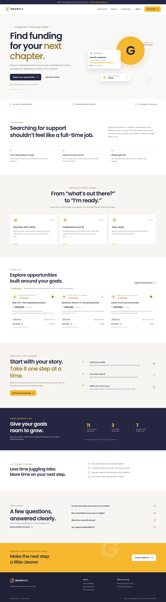
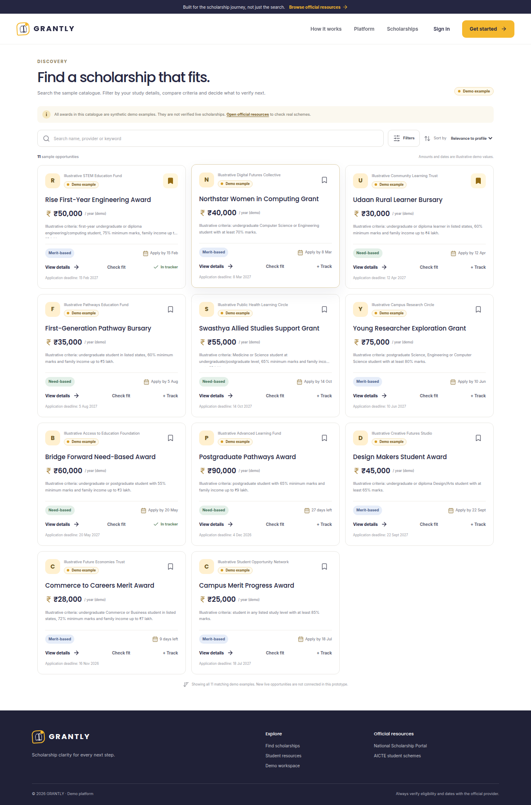
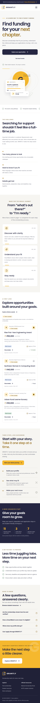

# GRANTLY — Discover Opportunities. Unlock Your Future.

GRANTLY is a scholarship discovery and management prototype for students. It brings a demo catalogue, transparent profile matching, a preparation checklist and application tracking into one responsive workspace.

> **Trust note:** the scholarships, sample providers, award amounts, criteria, notices and generated dates in the catalogue are synthetic examples for demonstrating the product. They are not verified offers or live announcements. The linked official portals are general references; they do not verify an individual synthetic record. Confirm current eligibility, dates, documents and application instructions directly with the provider.

## Problem and objective

Students often have to search across separate scholarship sites, interpret different eligibility rules, prepare documents and manage deadlines on their own. GRANTLY demonstrates a centralized workflow for discovery, explainable matching, document readiness and application tracking.

## Screenshots







The screenshots show responsive styling and visibly synthetic sample scholarship records; dashboard data is calculated from local demo progress.

## Features

- Public landing page, official resource directory and responsive navigation.
- Clearly labelled demo signup/login and admin-demo entry; demo passwords are never stored.
- Editable student profile with optional annual family income.
- Search, filter and sorting for a varied synthetic scholarship catalogue; record detail routes, source notes and preparation steps.
- Deterministic SmartMatch and a reusable eligibility checker that show matched, missing and mismatched criteria.
- Browser-persistent saved scholarships, seven-stage application tracker, personal notes and document-readiness checklist.
- Demo-only Funding Radar notices, educational preparation guides and state-derived Recharts dashboard analytics.
- Admin-demo CRUD for synthetic scholarships/notices, stored locally in this browser.
- Express REST endpoints for scholarships, notices, resources and health.

See [`FEATURES.md`](FEATURES.md) for feature boundaries and [`EVALUATION_MAPPING.md`](EVALUATION_MAPPING.md) for evaluator test paths.

## Technology

React 18, Vite 6, JavaScript ES modules, Tailwind CSS 4, Lucide React, React Router 6, Recharts 3, Zod, Node.js 20+, Express 5 and pnpm 10.18.0. The Express API serves the static production build when run in production mode. In local development, Vite serves the app on port 3000 and proxies `/api` to Express on port 3001.

## Architecture

- `src/pages/` contains public, discovery, dashboard, profile, tracker, checklist, notice, resource and admin-demo pages.
- `src/components/` contains the site/app shells, shared cards and accessible eligibility modal.
- `src/context/` contains browser-persisted student/demo state and the fetched catalogue with browser-only admin overrides.
- `src/data/` contains synthetic fixtures and links to official references.
- `src/utils/` contains deterministic SmartMatch, formatters, storage handling, validation and unit tests.
- `server/index.js` exposes REST endpoints and production static serving.
- `public/manus-routes.json` lists the page routes for managed Preview.

The API endpoints are `GET /api/health`, `GET /api/scholarships`, `GET /api/scholarships/:id`, `GET /api/notices` and `GET /api/resources`. The frontend uses same-origin `/api` by default and can be configured with `VITE_API_BASE_URL` for a separately hosted backend.

## Installation and local development

Requirements: Node.js 20 or newer and Corepack/pnpm 10.18.0.

```bash
corepack enable
pnpm install
pnpm dev
```

Open `http://localhost:3000`. Use **Explore the student demo** to enter the seeded student workspace, or **Explore admin demo** to see local-only management controls. The demo entry is simulated; it is not a real account service. The sign-up form accepts a display name, email and a temporary password field, but stores only the profile/session details. Login accepts any non-empty demo password and does not verify an account.

```bash
pnpm test
pnpm check
pnpm build
pnpm start
```

`pnpm start` serves `dist/` and the API on `PORT` (default 3000) and provides `/api/health` for readiness.

## Environment variables

Copy `.env.example` as a reference. No credential is required for the local demo.

- `PORT`: Express port (3000 by default; local dev starts the API separately on 3001).
- `VITE_API_BASE_URL`: optional public API origin for a Vercel frontend hosted separately from Express. Configure it at build time.
- `CORS_ORIGIN`: optional comma-separated list of exact browser origins permitted to call the API cross-origin. Keep this narrow.

Never put secrets in client-side `VITE_` variables. The app does not require Supabase/PostgreSQL or Gemini credentials in demo mode.

## Deployment

### Render

`render.yaml` defines a Node web service that builds the app and serves both Express API and frontend from the same origin. The health check is `/api/health`. Set `CORS_ORIGIN` only if a separate frontend needs cross-origin access.

### Vercel

`vercel.json` builds the static frontend and rewrites client routes to `index.html`. Deploy the Express API separately. Set `VITE_API_BASE_URL` at build time to the API origin and set the backend `CORS_ORIGIN` to the exact frontend origin. The browser client falls back to the synthetic bundled catalogue if the API cannot be reached, but production data synchronization is not configured.

A Dockerfile is included for containerized builds. This prototype has not been published from this repository.

## Official student resources

- [National Scholarship Portal](https://scholarships.gov.in/)
- [AICTE Student Development Schemes](https://www.aicte.gov.in/schemes/students-development-schemes)
- [UGC National Scholarship for Post Graduate Studies](https://www.ugc.gov.in/Scholarships/stu_Scholarship6)

These official destinations were reviewed while building the resource directory. External pages may change; follow the provider’s current instructions.

## Limitations and future scope

There is no production account authentication, database, email/reminder service, live scholarship feed, admin authorization or cross-device sync. Demo progress is kept in browser storage on this device; clearing site storage resets the local demo. Do not enter a reused password, sensitive identity information or bank details. SmartMatch is informational, uses only the listed synthetic criteria and does not determine official eligibility. No application is submitted through GRANTLY.

Future work, after appropriate provider data and credentials are configured, could add secure authentication, a persistent database with ownership and audit logs, verified scholarship ingestion and expiration, provider-driven notices, deadline notifications, and server-side authorization for administrative actions.
